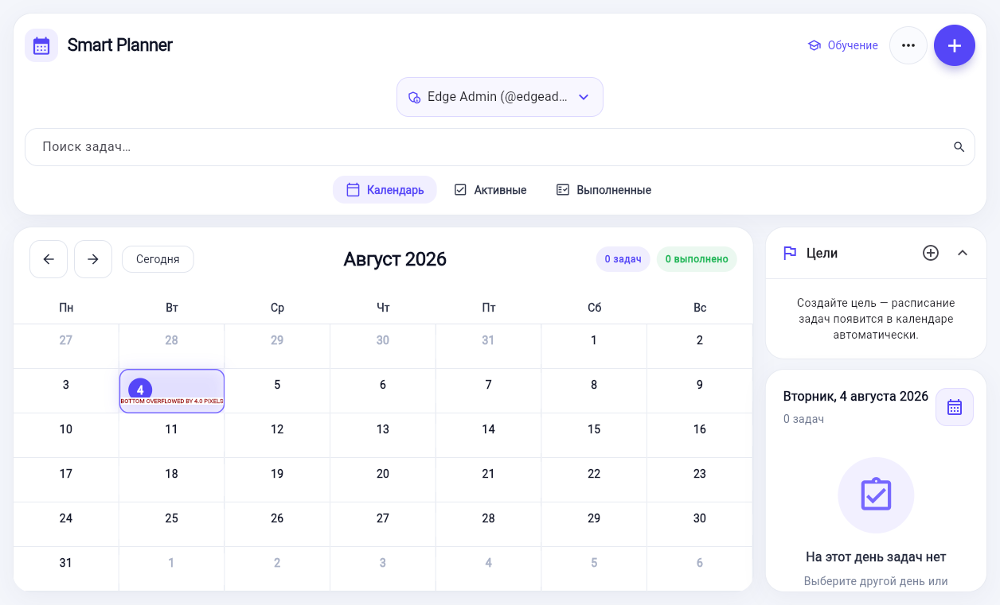
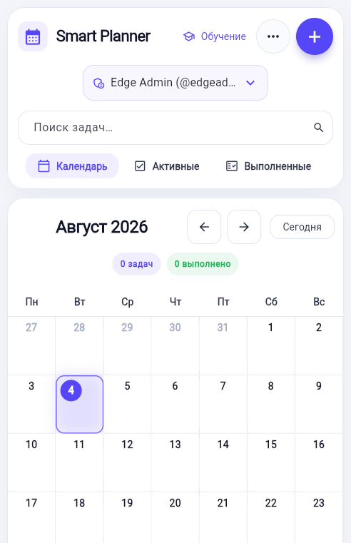
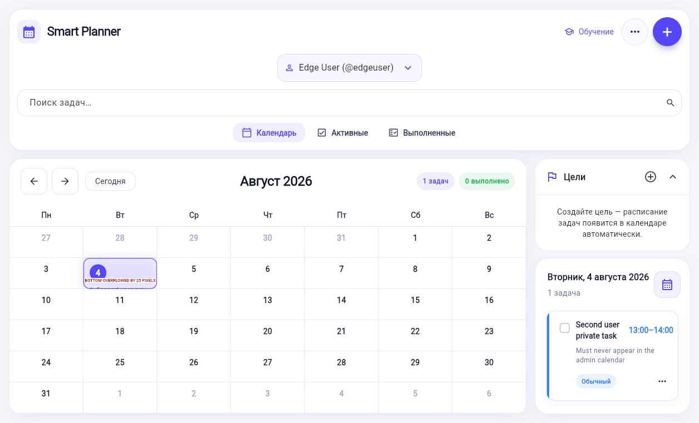
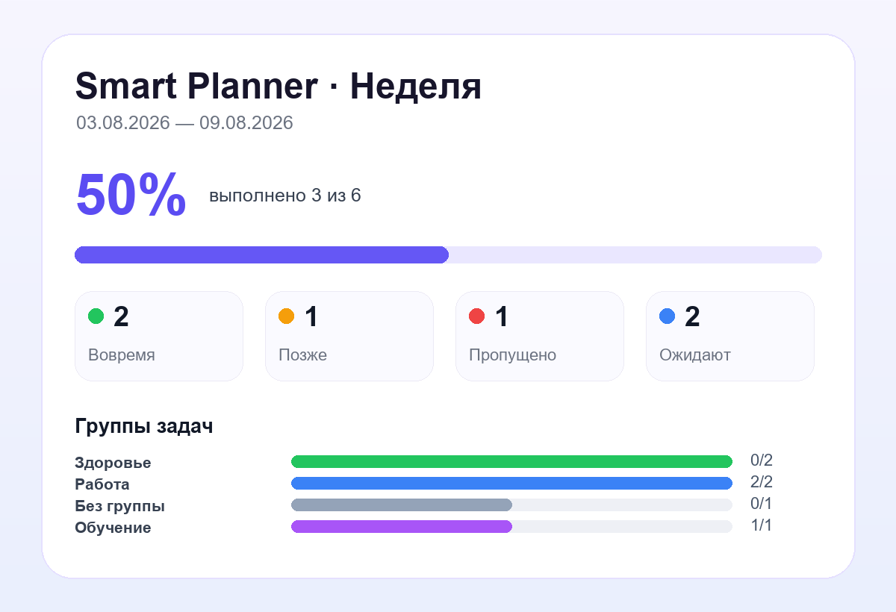

# Smart Planner

Личный планировщик, который я постепенно развивал от обычного Flutter-календаря до общей системы с Python API и Telegram-секретарём.

Веб-приложение помогает вести задачи и цели, а бот принимает текст или голос, разбирает несколько дел из одного сообщения, предлагает свободное время и сохраняет задачу только после подтверждения.



## Что я реализовал

- календарь с задачами, приоритетами, поиском и цветными группами;
- цели с повторениями, прогрессом и оценкой регулярности;
- Flutter Web-интерфейс для компьютера и телефона;
- Python Task API и общее SQLite-хранилище;
- разделение данных пользователей и администраторский доступ;
- Telegram-бота для работы с задачами через текст и голос;
- поиск свободного времени без пересечений с существующими делами;
- подтверждение перед созданием, переносом и удалением задач;
- недельные и месячные отчёты, включая PNG-карточки;
- модуль личных финансов и управление подписками;
- unit-, widget-, API- и браузерные тесты.

## Как это выглядит

### Мобильная версия



### Разделение пользователей



### Отчёт Telegram-бота



## Как устроен проект

```text
lib/                         Flutter-приложение
services/task_api/           Python API и работа с данными
services/tg_voice_bot/       Telegram-секретарь
test/                        Flutter-тесты
services/*/tests/            API- и bot-тесты
tool/                        браузерные end-to-end проверки
docs/                        подробности реализации
```

Flutter может работать локально через LocalStorage или подключаться к общему API. В общем режиме веб-приложение и Telegram-бот используют одно хранилище, поэтому изменения появляются в календаре без ручной перезагрузки.

## Быстрый запуск

Понадобятся Flutter, Python 3.10+ и Microsoft Edge или Chrome.

Запуск API:

```powershell
.\run_task_api.ps1
```

Запуск Flutter с API:

```powershell
.\run_web_with_api.ps1
```

Локальный режим без Python API:

```powershell
flutter pub get
flutter run -d edge
```

Для Telegram-бота скопируйте `services/tg_voice_bot/.env.example` в `.env` и заполните своими значениями. Рабочий `.env` в репозиторий добавлять нельзя.

## Проверки

```powershell
flutter analyze
flutter test
python -m unittest discover -s .\services\task_api\tests -v
python -m unittest discover -s .\services\tg_voice_bot\tests -v
.\tool\run_shared_stack_edge_tests.ps1
```

## Текущее состояние

Основные сценарии планировщика, общего API и Telegram-секретаря реализованы. Проект продолжаю развивать: в следующих версиях хочу улучшить персональные правила расписания и внешние календарные интеграции.

## Автор

Проект разработан мной самостоятельно: от структуры данных и API до Flutter-интерфейса, Telegram-сценариев и тестирования.

Перед публикацией замените эту строку на своё имя и GitHub-профиль.
